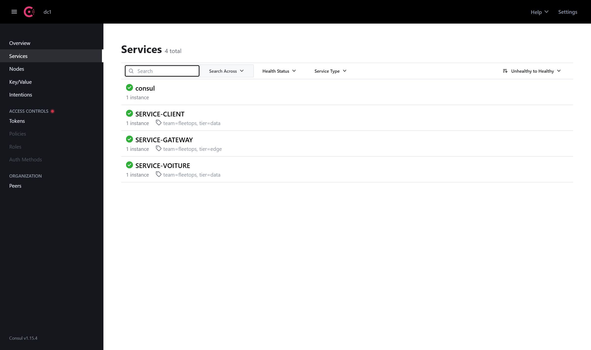
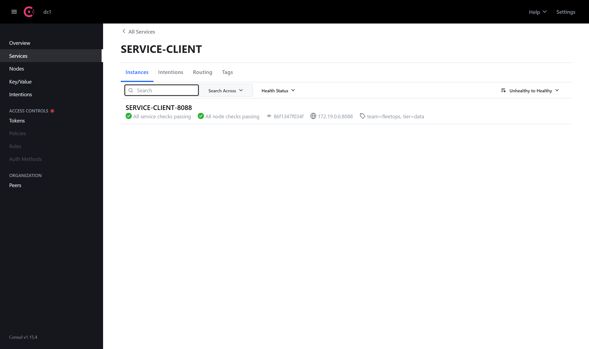
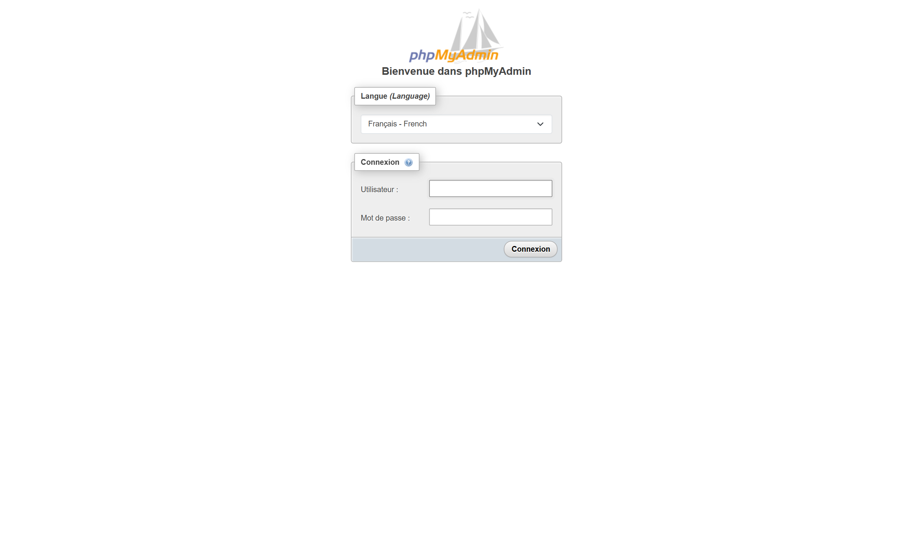
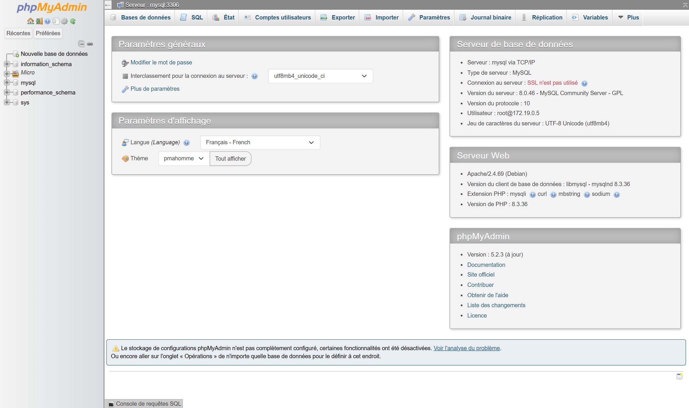
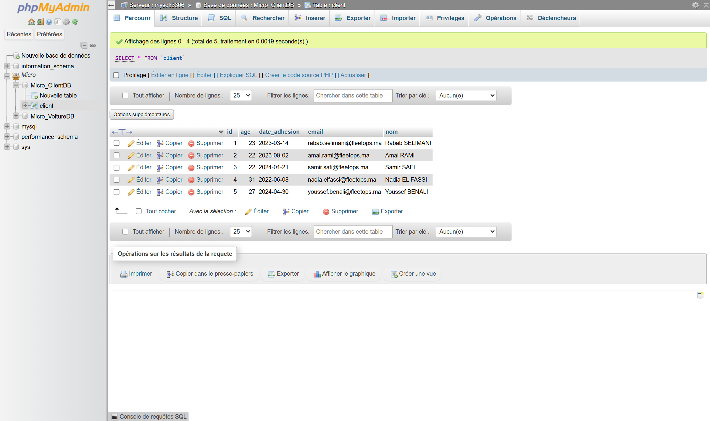
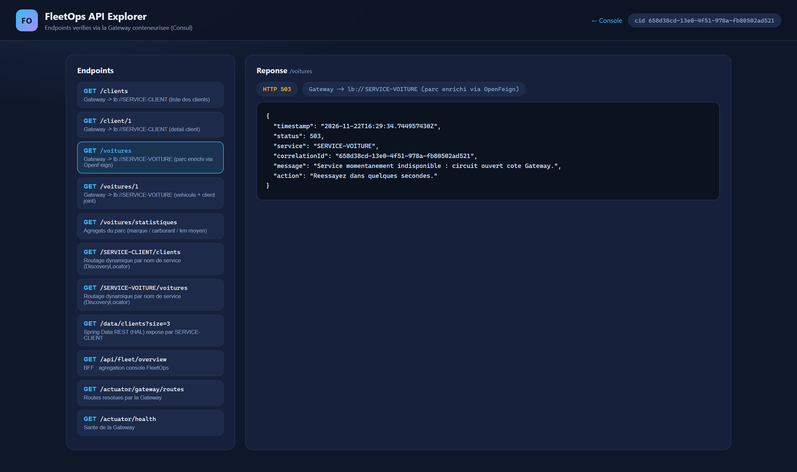
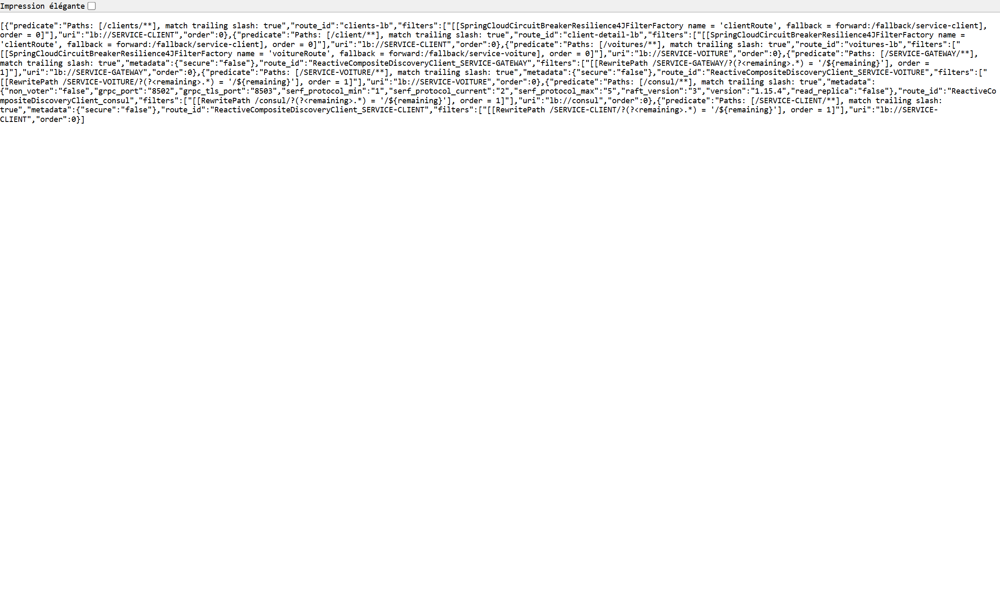
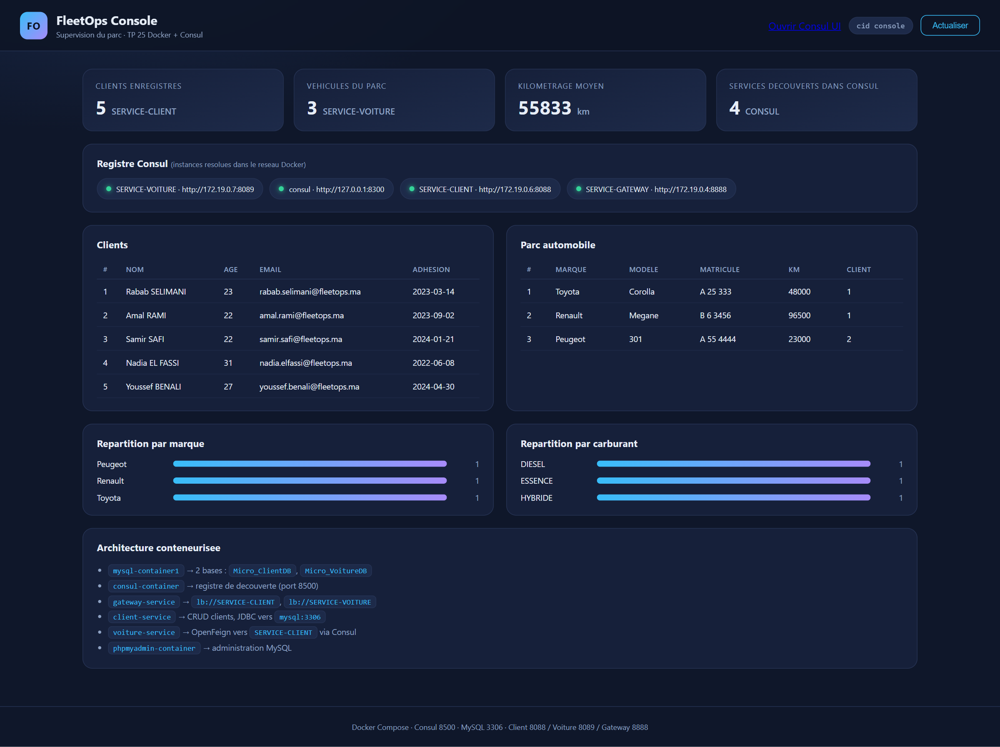
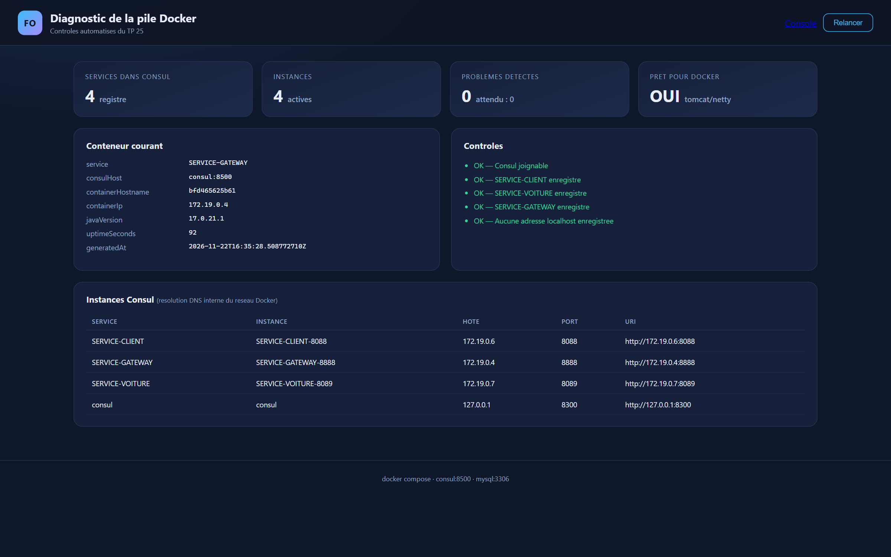

# TP 25 — Conteneurisation des microservices avec Docker + Consul
### Dockerfile multi-stage · Docker Compose · Consul Discovery

---

## 1. Consul : les 3 microservices enregistres dans le reseau Docker

  

  

---

## 2. MySQL et phpMyAdmin

  

  

  

---

## 3. Routage de la Gateway via Consul

   SERVICE-VOITURE" width="100%">

  

---

## 4. Console et diagnostic (fonctionnalite additionnelle)

  

  

